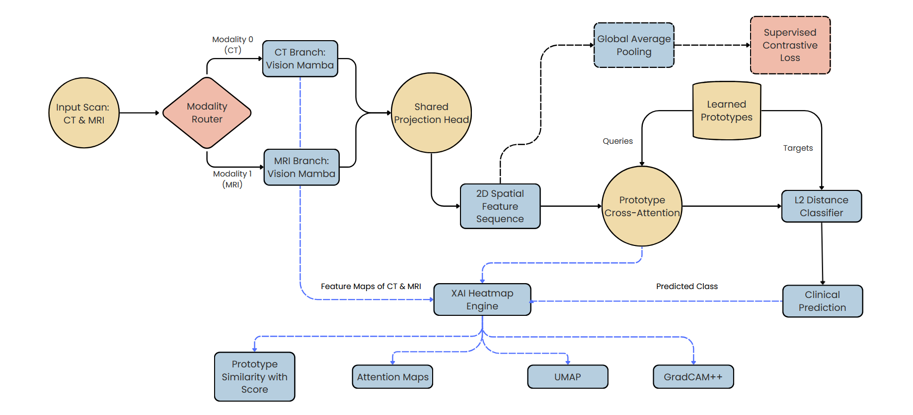

# Multimodal Brain Tumor Detection

A multimodal deep learning framework for **brain tumor classification** using paired **Computed Tomography (CT)** and **Magnetic Resonance Imaging (MRI)** images. The proposed framework integrates **Vision Mamba**, **Supervised Contrastive Learning**, **Prototype Cross-Attention**, and **Explainable AI (XAI)** to learn discriminative multimodal feature representations for accurate brain tumor classification.

---

## Project Status

This repository accompanies an ongoing research project. The implementation, documentation, and experimental pipeline are complete. Citation details and quantitative evaluation results will be updated following publication of the associated research paper.

---

## Proposed Architecture

<p align="center">
  
</p>

<p align="center">
<b>Figure 1.</b> Overall architecture of the proposed multimodal CT–MRI brain tumor detection framework.
</p>

---

## Proposed Approach

The proposed framework processes paired **CT** and **MRI** images through dedicated **Vision Mamba** encoders to extract modality-specific feature representations. These representations are projected into a shared latent space using a **Shared Projection Head**, enabling unified multimodal feature learning.

The shared embeddings are optimized using **Supervised Contrastive Learning** to improve class discrimination. The resulting feature representations are refined through a **Prototype Cross-Attention** module, where image features interact with learnable class prototypes to generate prototype-guided embeddings. Final predictions are produced using an **L2 Distance Classifier**.

Model interpretability is enhanced through an integrated **Explainable AI (XAI)** pipeline comprising **Grad-CAM++**, **UMAP** feature visualization, and **Prototype Similarity Analysis**.

---

## Key Features

* Multimodal CT–MRI brain tumor classification
* Dual Vision Mamba feature extraction
* Shared latent representation learning
* Supervised Contrastive Learning
* Prototype Cross-Attention
* L2 Distance-based classification
* Explainable AI (Grad-CAM++, UMAP, and Prototype Similarity Analysis)
* Robust evaluation using **5-fold cross-validation**
* Designed for scalable multimodal medical image analysis

---

## Environment

The proposed framework was developed and evaluated using the following software and hardware environment.

| Component | Specification                |
| --------- | ---------------------------- |
| Platform  | Google Colab                 |
| GPU       | NVIDIA Tesla T4 (16 GB VRAM) |
| Python    | 3.11                         |
| PyTorch   | 2.x                          |
| CUDA      | 12.x                         |

The framework is compatible with CUDA-enabled GPUs with sufficient memory.

---

## Documentation

Additional documentation is provided in the following files.

| File           | Description                                  |
| -------------- | -------------------------------------------- |
| `DATASET.md`   | Dataset overview and download instructions   |
| `INSTALL.md`   | Installation and environment setup           |
| `TRAINING.md`  | Training methodology and evaluation protocol |
| `INFERENCE.md` | Inference workflow                           |
| `RESULTS.md`   | Evaluation summary and future updates        |

---

## Repository Structure

```text
Multimodal-Brain-Tumor-Detection/
│
├── architecture/
│   └── model_architecture.png
│
├── notebooks/
│   └── Multimodal_Brain_Tumor_Detection.ipynb
│
├── DATASET.md
├── requirements.txt
├── INSTALL.md
├── TRAINING.md
├── INFERENCE.md
├── RESULTS.md
├── LICENSE
├── .gitignore
└── README.md
```

---

## Quick Start

Clone the repository:

```bash
git clone https://github.com/shantanu0078/Multimodal-Brain-Tumor-Detection.git
cd Multimodal-Brain-Tumor-Detection
```

Install the required dependencies:

```bash
pip install -r requirements.txt
```

Launch the Jupyter notebook:

```text
notebooks/Multimodal_Brain_Tumor_Detection.ipynb
```

For detailed setup and usage instructions, refer to:

* `INSTALL.md`
* `TRAINING.md`
* `INFERENCE.md`

---

## Contributors

This repository accompanies a collaborative research project developed by a team of three members.

**Shantanu Mandal**

**Primary Contributions**

* Implementation of the proposed multimodal deep learning framework
* Development of the training and evaluation pipeline
* Model training, experimental evaluation, and hyperparameter optimization
* Integration of Explainable AI (Grad-CAM++, UMAP, and Prototype Similarity Analysis)
* Contributions to the design and development of the proposed framework
* Repository organization and technical documentation

---

## Citation

Citation information will be provided following publication of the associated research paper.

---

## License

This project is licensed under the **MIT License**. See the `LICENSE` file for details.
